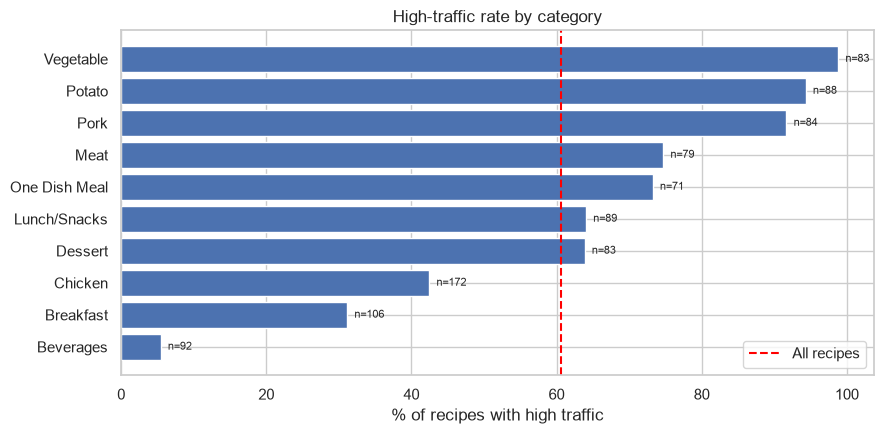

# Which recipes bring traffic to the site?

A recipe website features one recipe on its home page each day, and a popular choice lifts traffic across the whole site. This project predicts which recipes will produce high traffic, with the goal of being right at least 80% of the time when it recommends one.



## Result

On 190 held-out recipes, the model recommended 72 and 66 of them were high-traffic: **92% precision** against a 61% base rate. Cross-validation on the training data, the more cautious estimate, gave 82%.

| Approach | Recommended | High traffic | Precision | Recall |
|---|---|---|---|---|
| Logistic regression, all features | 72 | 66 | 91.7% | 57.4% |
| Logistic regression, category only | 70 | 64 | 91.4% | 55.7% |
| Random forest | 79 | 68 | 86.1% | 59.1% |
| Rule: five categories | 70 | 64 | 91.4% | 55.7% |

The most useful finding is that the model is barely needed:

- **Category does nearly all the work.** Vegetable (99%), potato (94%) and pork (92%) recipes almost always bring high traffic. Beverages (5%) almost never do.
- **A one-line rule matches the model:** feature recipes from the Meat, One Dish Meal, Pork, Potato and Vegetable categories.
- **Nutrition and servings add nothing measurable.**
- **The cost of high precision is recall.** A little over half of all high-traffic recipes are found; desserts and lunch/snacks, which are high-traffic about 64% of the time, are never recommended.

The recommendation is to start with the category rule, and to collect information that varies within a category (preparation time, cost, ingredients, the photo) before investing in a more complex model.

## Approach

1. **Validate and clean:** convert the blank/"High" target to 0/1, extract the number from text servings ("4 as a snack"), merge a duplicated category, and keep the 52 recipes with missing nutrition (imputed inside the pipeline).
2. **Explore:** traffic rate by category, nutrition and servings.
3. **Model:** logistic regression (category only, and all features) and a random forest, compared with five-fold cross-validation.
4. **Choose a threshold** on cross-validated predictions to meet the precision goal, then score once on the test set.
5. **Check a plain rule** against the models.

## Data

`data/recipe_site_traffic.csv`: 947 featured recipes with calories, carbohydrate, sugar, protein, category, servings and whether traffic was high.

## Running it

```bash
pip install -r requirements.txt
jupyter notebook notebook.ipynb
```

## Caveats

"Not high" is inferred from blank values in the data, and every recipe in it was already chosen by a person to be featured. The test set is 190 recipes, so the precision estimate has a margin of several points.
